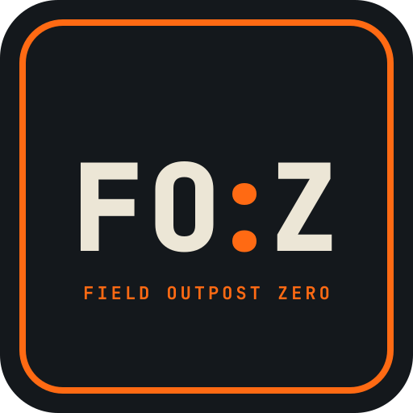

<p align="center"></p>

# Field Outpost: Zero

## SDR Bugout Box ("Fozzie")

A portable, self-contained software-defined radio (SDR) platform built into a small plastic case, a grab-and-go rig that can receive (and eventually transmit) across a wide range of frequencies, with its own display, input, and power — no laptop required.

## More Details

Build a rugged, portable SDR station inside a small plastic enclosure:

- **Self-contained** — display, keyboard/pointer input, and compute all in the case
- **Battery-capable** — usable off-grid / in the field
- **Upgradeable** — start with an inexpensive RTL-SDR, move to higher-bandwidth hardware later without rebuilding
- **Multi-radio** — SDR reception plus LoRa (Heltec V3) and GPIO for external hardware
- **Printable internals** — custom 3D-printed brackets and cradles to mount everything inside the case

Primary use cases: general wideband monitoring, ADS-B aircraft tracking, weather satellite decoding, ham radio waterfall/spectrum display, and experimentation.

## Hardware

### Compute: Orange Pi 4 Pro

Chosen over Raspberry Pi on price/performance grounds. Key specs:

| Component | Specification |
|---|---|
| SoC | Allwinner A733 (12nm) |
| CPU | 2× Cortex-A76 @ 2.0 GHz + 6× Cortex-A55 @ 1.8 GHz |
| Coprocessor | RISC-V XuanTie E902 real-time core |
| GPU | Imagination BXM-4-64 (OpenGL ES 3.2, Vulkan 1.2, OpenCL 3.0) |
| NPU | 3 TOPS (INT8/INT16/FP16/BF16) |
| RAM | 4 GB LPDDR5 (board supports up to 16 GB) |
| Storage | M.2 NVMe (PCIe 3.0 ×1), microSD, eMMC socket |
| Connectivity | Wi-Fi 6, Bluetooth 5.4, 1× Gigabit Ethernet (PoE HAT ready) |
| USB | 1× USB 3.0 Type-A, 3× USB 2.0 Type-A |
| Power | Dedicated USB-C port — **power only**, no data/OTG |
| Display out | HDMI 2.0, 4-lane MIPI DSI |

**Notes and gotchas:**

- The USB-C port is power-only. Data OTG and bootloader flashing go through the top USB 3.0 Type-A port.
- The A733 runs hot under sustained multi-threaded load; it will throttle around 90 °C without a heatsink or fan.
- Idle draw is roughly 3–4 W headless; rarely spikes past 8 W under load.
- Mainstream Linux GPU driver support for the Imagination BXM GPU is still maturing, so CPU video decoding can be sluggish for 4K desktop media playback. Not a concern for SDR work.
- **4 GB RAM is the baseline.** Fine for headless SDR, DSP pipelines, and lightweight desktop use. It will bottleneck with a heavy browser session or large media indexing.

### SDR: RTL-SDR (starting point)

Starting with an RTL-SDR dongle (~$20–30 USD for an RTL-SDR Blog V3/V4) as a cost-effective entry point. The Orange Pi 4 Pro is overkill for an RTL-SDR, which is intentional — it leaves headroom for the upgrade path.

**Planned upgrade path** (unplug dongle, plug in new device, install drivers):

| Device | Approx. price (USD) | Why |
|---|---|---|
| RTL-SDR Blog V3/V4 | $20–30 | Entry point, huge software ecosystem |
| Airspy Mini | ~$100 | Higher sample rate, better dynamic range |
| SDRplay RSP1A | ~$110 | Wideband, good sensitivity |
| Airspy R2 | ~$170 | Up to 10 MHz bandwidth |
| SDRplay RSPdx | ~$220 | High dynamic range, wideband |
| HackRF One | $300–350 | 1 MHz–6 GHz, half-duplex TX/RX |
| LimeSDR Mini | $300–350 | 10 MHz–3.5 GHz, up to 30.72 MHz bandwidth |

### LoRa: Heltec V3

ESP32-S3 + LoRa module. Connects either over USB (registers as `/dev/ttyACM0` or `/dev/ttyUSB0` via CP210x/CDC-ACM) or wired to the board's UART2 expansion pins to free up a USB port. Intended for Meshtastic or custom serial packet work.

### Display and input

- LCD display and keyboard/touchpad combo sourced from AliExpress (specific models TBD)
- Display connects over HDMI 2.0 for simplicity; a bare MIPI DSI ribbon panel would need manual device-tree work on Allwinner under Armbian/Ubuntu
- **Open question:** exact display and keyboard models, and whether they'll fit the case

### Storage

- microSD for initial bring-up (simplest way to test the board)
- eMMC module or M.2 NVMe SSD as the eventual primary boot device — both are significantly faster than the SD interface

## Software

### OS choice

Targeting **Armbian** or **official Debian 12 (Bookworm)** with a lightweight desktop (XFCE or LXQt).

| Option | Verdict |
|---|---|
| Official Debian 12 / Ubuntu 24.04 | Stable, vendor drivers baked in, good out-of-box hardware support |
| Armbian | Preferred for power users — clean core, `armbian-config` simplifies enabling UART/SPI/I2C/PWM via device-tree overlays |
| Android | Not recommended — poor support for custom DSP, raw serial, and GPIO |

### SDR software

- **SDR++** or **GQRX** for GUI waterfall/spectrum
- **CubicSDR** as a lightweight alternative
- **GNU Radio** for DSP flowgraphs (needs the quad-core ARM64 headroom)
- **rtl_tcp** / SDR++ Server for headless operation
- **dump1090** for ADS-B, **rtl_433** for ISM-band devices

### Known setup steps

Blacklist the kernel DVB-T driver so it doesn't claim the RTL2832U chip:

```bash
echo "blacklist dvb_usb_rtl28xxu" | sudo tee /etc/modprobe.d/blacklist-dvb.conf
```

For an RTL-SDR Blog V4, the stock `librtlsdr` in apt repos won't recognise it — build the updated drivers:

```bash
sudo apt-get install libusb-1.0-0-dev git cmake build-essential
git clone https://github.com/rtlsdrblog/rtl-sdr-blog
cd rtl-sdr-blog && mkdir build && cd build
cmake ../ -DINSTALL_UDEV_RULES=ON
make && sudo make install
sudo ldconfig
```

(A standard V3 or generic dongle works with plain `sudo apt install rtl-sdr`.)

Add a udev rule (`/etc/udev/rules.d/20-rtlsdr.rules`) so SDR apps can access the raw IQ stream without root.

### GPIO

Use `gpiod` rather than legacy wiringPi:

```bash
sudo apt install gpiod python3-gpiod
```

Provides clean, non-root access to `/dev/gpiochip*` for reading switches, triggering relays, or driving status LEDs from Python.

### GPIO header and Raspberry Pi HAT compatibility

The board has a **40-pin header laid out to match the Raspberry Pi pinout** — same physical pitch, same positions for power, ground, and the common buses. It exposes GPIO, UART, I²C, SPI, and PWM. Many Raspberry Pi HATs will physically seat on it.

**"Raspberry Pi compatible" is not the same as "plug and play."** The caveats:

| Issue | Detail |
|---|---|
| Software, not pins | Pi HATs are driven by `RPi.GPIO` / `gpiozero` with Pi-specific device-tree overlays. On Allwinner you're on a different device tree with different bus numbering. Expect to enable I²C/SPI/UART manually and repoint code at the correct bus (e.g. `/dev/i2c-2` instead of `/dev/i2c-1`). |
| Alternate functions differ | The 40 pins are laid out the same, but which SoC peripheral lands on which pin is **not guaranteed to match**. A HAT using SPI0 chip-select on pin 24 may find that pin wired to a different controller. This is the failure mode that looks fine until one peripheral doesn't respond. |
| No HAT EEPROM | The official HAT spec includes an ID EEPROM the Pi reads to auto-load the right overlay. The Orange Pi does not implement this — no auto-detection, no auto-configuration. |
| Physical mounting | The header's position relative to the mounting holes is **not** the Pi standard. HATs with standoffs or that expect to sit flush will not line up; use a ribbon cable or adapter board. |
| Power | Do not power the board through the 5 V header pins — use the USB-C port. HATs drawing significant current from the header may brown out. |

**Likely outcomes by HAT type:**

| HAT type | Likely outcome |
|---|---|
| Simple I²C sensor breakouts | Usually works; may need bus renumbering |
| SPI displays | Often works; verify the chip-select pin |
| PoE HATs | Reported working on some Orange Pi boards when the pinout aligns |
| Audio / I²S HATs | Frequently problematic — prefer generic I²S components |
| Anything with a HAT EEPROM | No auto-config; manual setup required |
| Mechanically-mounted HATs | Won't align; needs a ribbon cable |

**Naming caution:** the Orange Pi 4 Pro is easy to confuse with the **Orange Pi 4 LTS** (RK3399, 26-pin header) and the **Orange Pi Zero 4** (split 26+13 pin header). Verify any documentation or forum post is actually about the 4 Pro.

## Power and RF considerations

- **Power supply:** the board needs a solid **5 V / 3 A+** supply. Cheap supplies brown out when an SDR dongle and an HDMI touch interface are both drawing current.
- **USB current:** RTL-SDR dongles draw up to 300 mA and run hot. Use a **powered USB hub** if running multiple peripherals alongside the SDR.
- **RF noise / EMI:** SBC power supplies and HDMI lines radiate interference across HF/VHF. Keep the dongle on a short, shielded USB extension away from the board and HDMI cable rather than plugged directly into a board port.
- **Battery:** not yet specified — open question.

## Enclosure and printable mounting system

A modular set of brackets, shims and faceplates for building the kit into a
Pelican-style case without drilling the base. Everything is parametric
OpenSCAD (`parts/`), with ready-to-print STLs at default sizes (`stl/`) and
renders (`preview/contact_sheet.png`).

### Tolerances reference

| Application | Recommended clearance | Technique |
|---|---|---|
| Board base / pocket fits | +0.3 to +0.4 mm total | Room for board edge variation without binding |
| M3 machine screw holes | 3.3–3.4 mm diameter | FDM internal holes print undersized |
| Heat-set threaded inserts | Match insert outer diameter exactly | Plastic melts into the brass knurling |
| First layer compensation | 0.5 mm × 45° chamfer on bottom edges | Prevents elephant's foot reducing tolerances |
| Component entry guides | 1.0 mm chamfers on internal slots | Smooth sliding of PCBs and displays |

## How it fits together

**Base: a 20 mm grid.** The floor is covered with `base_tile` tiles
(100 x 100 mm by default) that dovetail together. Each tile has an M3 nut
captured under every grid hole. The assembled floor sticks down with VHB
tape, and `wall_jack`s and `wedges` lock it against the case walls, so the
case keeps its seal. Every bracket has a slotted "grid foot", so it bolts down
anywhere with M3 x 10 screws and slides up to one cell for fine adjustment.

| Part | What it holds |
|---|---|
| `board_tray` | Orange Pi on raised standoffs, vented underneath |
| `strap_cradle` | Anker pack, open at the port end, with a velcro strap under and over it |
| `dongle_clip` | RTL-SDR, snap fit plus a cable-tie slot |
| `faceplate` + `faceplate_post` | Swappable connector panels, N x 20 mm wide and 40 or 60 mm tall |
| `shims` | 1 to 5 mm spacers, wall wedges, wall jacks with pads |

**Faceplates.** Two posts bolt to the grid and a faceplate screws to their
faces into captive nuts. Start with blanks, then add cutouts in the
`CUTOUTS` list as parts arrive. The file lists hole sizes for SMA, BNC,
USB-C, DC jack, GX12 aviation, toggle switch and 3.5 mm jack.

**Lid** (243 x 215 x 25 mm outside, about 22 mm deep inside). See
`preview/lid_assembly.png`.

- `lid_plate` uses the same 20 mm grid, cut to the inside outline of the lid with its rounded corners. It's VHB'd to the inside of the lid and prints as two dovetailed halves, so it fits a 220 mm bed.
- `lid_display` is the screen module. The bezel (with a debossed FO:Z badge) and clamp sandwich the panel on foam. M3 screws go in from the front into heat-set inserts. The clamp's ears bolt to the lid grid, so the screen comes out in one piece. The stack is 17 mm above the lid floor, which leaves about 5 mm before the rim.
- The **driver board sits beside the panel** on its own `driver_tray` (`board_tray.scad` with driver sizes), not behind it. Behind the panel the stack would be about 30 mm, which is too deep for the lid. With a 7" panel, the module fills the six grid rows away from the hinge and the driver tray fits in the four rows by the hinge. The short HDMI lead then crosses the hinge to the Pi.
- `lid_antenna` covers weatherproof SMA bulkheads in the **lid side wall opposite the hinge**. With the lid open that edge points up, so antennas stand vertical, which suits VHF/UHF. The drill template and the inside backer (bonded on) fit the wall above the lid plate. Fit the O-ring outside and keep dust caps on when not in use. RG316 pigtails run to the SDR with a slack loop across the hinge.

## Before printing: measure these

The defaults are placeholders, so set these at the top of each file:

1. **Case interior** floor size and wall draft. Set `NX`/`NY` and `TRIM_X`/`TRIM_Y` in `base_tile.scad` for the edge tiles.
   **Lid interior**: measure the inside of the lid *at its floor* (the taper makes it smaller there than at the rim), take off 1 mm each side, and set `LID_IN_W` / `LID_IN_D` in `lid_plate.scad`. The current 231 x 203 is an estimate from the outside size.
   **Corner radius**: print `radius_gauge` (ten tabs, R4 to R30). Push tabs into the inside corner at the floor. The right one sits flat on both walls with no gap at the curve. If it rocks it's too small, and if it gaps at the curve it's too big. No printer handy? Try coins: the coin that touches both walls and the curve at once has a radius equal to the corner's. Or press paper into the corner, crease it, and match the curve against circles of known size. Set `LID_R`.
2. **Orange Pi 4 Pro mounting holes.** The board is 89 x 56 mm, but the hole spacing isn't published. The file uses the Raspberry Pi pattern (58 x 49) until you measure.
3. **LCD panel** outline, thickness, active area, ribbon-cable edge, and the **driver board** size and holes (`lid_display.scad`).
4. **Anker pack** length x width x thickness (`strap_cradle.scad`).
5. **RTL-SDR** width and height if it isn't a Blog v4 (`dongle_clip.scad`).

## Printing

- PETG or ASA. PLA softens in a closed case in the sun. TPU for wedges and jack pads.
- 0.2 mm layers, 4 walls, 30-40% infill. Every part prints flat as rendered, with no supports.
- Print one `base_tile` and one `shims` spacer set first to check that nuts press in and M3 screws slide in the slots. Adjust `M3_NUT_AF` / `M3_CLEAR` in `bugout.scad` if they don't.

## Hardware

- M3 x 10 socket screws and M3 nuts: about 1 per grid hole you use, so a bag of 100 of each.
- M3 heat-set inserts (lid bezel, 8 off).
- M2.5 x 6 self-tappers for board standoffs.
- VHB tape, 20-25 mm velcro strap, 1-2 mm craft foam.
- SMA bulkhead jacks with O-rings and dust caps, RG316 SMA pigtails.

## Regenerating STLs

```
openscad -o stl/board_tray.stl parts/board_tray.scad
openscad -o stl/faceplate.stl -D 'PART="plate"' parts/faceplate.scad
```

---

# Current status

- [x] Orange Pi 4 Pro received
- [x] OS image downloaded (`Orangepi4pro_1.1.0_debian_trixie_desktop_xfce_linux6.6.98.7z`) and extracted
- [x] Image checksum verified (SHA-256 OK)
- [x] microSD card acquired (32 GB minimum, 64 GB preferred; A2-rated for better random I/O)
- [x] Image flashed to card
- [x] First boot and HDMI output confirmed
- [ ] Display and keyboard/touchpad sourced and fitted
- [ ] RTL-SDR dongle acquired and working
- [ ] Heltec V3 integrated
- [ ] Case internals designed and printed
- [ ] Battery/power solution designed

## Open questions

- Exact LCD display and keyboard/touchpad models — do they fit the case?
- Battery solution: capacity, chemistry, charging, and how it integrates with the 5 V/3 A requirement
- Boot device: microSD, eMMC module, or NVMe? (NVMe is fastest but adds cost and heat)
- Antenna strategy: what to mount, where, and how to route the feed
- Whether to add a powered USB hub inside the case or rely on the board's ports
- Cooling: heatsink vs. small fan, and how it fits the enclosure
- 4 GB vs. 8 GB RAM — is 4 GB enough long-term for the desktop use case?

## Notes

- Australian pricing carries a significant premium over USD. Local options worth checking: Core Electronics, Element14 Australia, Jaycar, Altronics, Officeworks (for storage). Watch for EOFY and Black Friday sales.
- Hardkernel ships internationally; compare landed cost (including import duties/GST) against local resellers.
